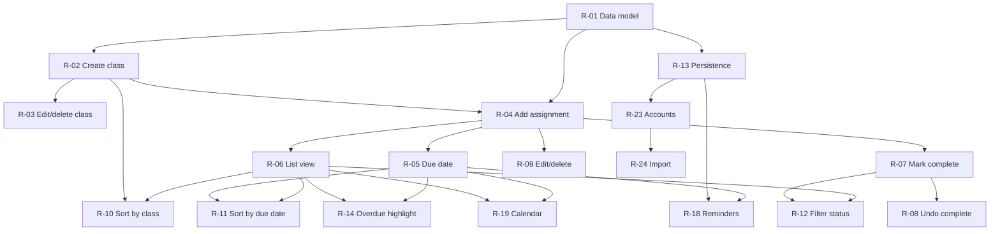

# Assignment Tracker: Initial Requirements Backlog

Output of a first pass of requirements elicitation. Managed with **Kanban**: items are pulled from the backlog by current priority, with no sprints. Suggested board columns: `Backlog → Ready → In Progress → Review → Done` (set a WIP limit of 2–3 on In Progress).

## Metadata key

| Field | Values |
|---|---|
| **Type** | Functional (F), Non-functional (NF), Constraint (C) |
| **Priority** | Must / Should / Could / Won't (for now), MoSCoW |
| **Size** | S (≤ 1 day), M (2–3 days), L (a week or more) |
| **Depends on** | IDs that must be done (or at least started) first |
| **Tags** | Area of the system the item touches |

## Summary table

| ID | Title | Type | Priority | Size | Depends on | Tags |
|---|---|---|---|---|---|---|
| R-01 | Data model for assignments and classes | C | Must | M | none | data, foundation |
| R-02 | Create a class | F | Must | S | R-01 | classes |
| R-03 | Edit and delete a class | F | Should | S | R-02 | classes |
| R-04 | Add an assignment | F | Must | M | R-01, R-02 | assignments, core |
| R-05 | Set a due date and time | F | Must | S | R-04 | assignments, dates |
| R-06 | View all assignments in a list | F | Must | M | R-04 | assignments, ui |
| R-07 | Mark assignment complete | F | Must | S | R-04 | assignments, status |
| R-08 | Undo completion (mark incomplete) | F | Should | S | R-07 | assignments, status |
| R-09 | Edit and delete an assignment | F | Must | S | R-04 | assignments |
| R-10 | Sort or group by class | F | Must | M | R-06, R-02 | sorting, classes |
| R-11 | Sort by due date | F | Must | S | R-06, R-05 | sorting, dates |
| R-12 | Filter by completion status | F | Should | S | R-06, R-07 | filtering, status |
| R-13 | Persistent storage across sessions | NF | Must | M | R-01 | data, persistence |
| R-14 | Highlight overdue and due-soon items | F | Should | S | R-05, R-06 | dates, ui |
| R-15 | Input validation and error messages | NF | Should | S | R-04, R-05 | quality, ui |
| R-16 | Assignment notes and description | F | Could | S | R-04 | assignments |
| R-17 | Priority or weight per assignment | F | Could | S | R-04 | assignments, sorting |
| R-18 | Reminders and notifications | F | Could | L | R-05, R-13 | dates, notifications |
| R-19 | Calendar view | F | Could | L | R-05, R-06 | ui, dates |
| R-20 | Responsive layout (mobile and desktop) | NF | Should | M | R-06 | ui, accessibility |
| R-21 | Accessibility (keyboard nav, contrast, screen reader labels) | NF | Should | M | R-06 | accessibility |
| R-22 | Automated tests for core features | NF | Should | M | R-04, R-07, R-10 | quality, testing |
| R-23 | User accounts and sync across devices | F | Won't (for now) | L | R-13 | accounts, sync |
| R-24 | Import deadlines from syllabus or LMS | F | Won't (for now) | L | R-04, R-23 | integration |

## Requirement details

### R-01: Data model for assignments and classes
- **As a** developer, **I need** a defined schema for classes and assignments **so that** all features build on one consistent structure.
- **Fields:** Class (id, name, optional course code, optional color). Assignment (id, title, class_id, due_date, completed flag, completed_at, optional notes).
- **Acceptance:** An assignment cannot exist without a class. Schema is documented in the repo.

### R-02: Create a class
- **As a** student, **I want** to add a class **so that** I can organize assignments under it.
- **Acceptance:** Class names are required and unique. New class appears immediately in class selectors.

### R-03: Edit and delete a class
- **Acceptance:** Deleting a class warns the user and either deletes or reassigns its assignments.

### R-04: Add an assignment
- **As a** student, **I want** to add an assignment with a title and class **so that** I can track what I owe.
- **Acceptance:** Title and class are required. The new item appears in the list without a page reload.

### R-05: Set a due date and time
- **Acceptance:** Date is required, time is optional (defaults to end of day). Dates can be edited later.

### R-06: View all assignments in a list
- **Acceptance:** Each row shows title, class, due date, and completion state. Empty state shows a helpful message.

### R-07: Mark assignment complete
- **Acceptance:** One click or tap toggles completion. Completed items are visually distinct and record `completed_at`.

### R-08: Undo completion
- **Acceptance:** A completed item can be returned to incomplete in one action.

### R-09: Edit and delete an assignment
- **Acceptance:** Deletion asks for confirmation. All fields are editable.

### R-10: Sort or group by class
- **As a** student, **I want** to see assignments by class **so that** I can focus on one course at a time.
- **Acceptance:** User can group the list by class or filter to a single class.

### R-11: Sort by due date
- **Acceptance:** Soonest first by default. Toggle for ascending or descending.

### R-12: Filter by completion status
- **Acceptance:** Views for All, Active, and Completed. Completed items hidden by default is configurable.

### R-13: Persistent storage across sessions
- **Acceptance:** Data survives closing and reopening the app. Storage choice (local file, SQLite, browser storage, etc.) recorded as a design decision.

### R-14: Highlight overdue and due-soon items
- **Acceptance:** Overdue incomplete items are clearly flagged. "Due soon" window (e.g., 48 hours) is defined and consistent.

### R-15: Input validation and error messages
- **Acceptance:** Invalid or missing input produces a clear message and never corrupts stored data.

### R-16: Assignment notes and description
- **Acceptance:** Optional free-text field shown on detail view.

### R-17: Priority or weight per assignment
- **Acceptance:** Optional low/medium/high value; usable as a sort key.

### R-18: Reminders and notifications
- **Acceptance:** User can opt in to a reminder a set time before the due date. Needs a decision on delivery channel (in-app, email, push).

### R-19: Calendar view
- **Acceptance:** Month and week views show assignments on their due dates, color-coded by class.

### R-20: Responsive layout
- **Acceptance:** Usable at phone widths and on desktop without horizontal scrolling.

### R-21: Accessibility
- **Acceptance:** All actions reachable by keyboard, color is never the only indicator of state, labels exist for assistive tech.

### R-22: Automated tests for core features
- **Acceptance:** Tests cover add, complete, edit, delete, sort, and filter paths and run on every push.

### R-23: User accounts and sync (deferred)
- Out of scope for the first release. Revisit once the single-user version is stable.

### R-24: Import from syllabus or LMS (deferred)
- Out of scope for the first release. Depends on accounts and a stable assignment model.

## Dependency overview

## Suggested first Kanban pulls

Core path to a usable tracker: **R-01 → R-02 → R-04 → R-05 → R-06 → R-07 → R-10 → R-13**. Everything else can be pulled as priorities shift.
